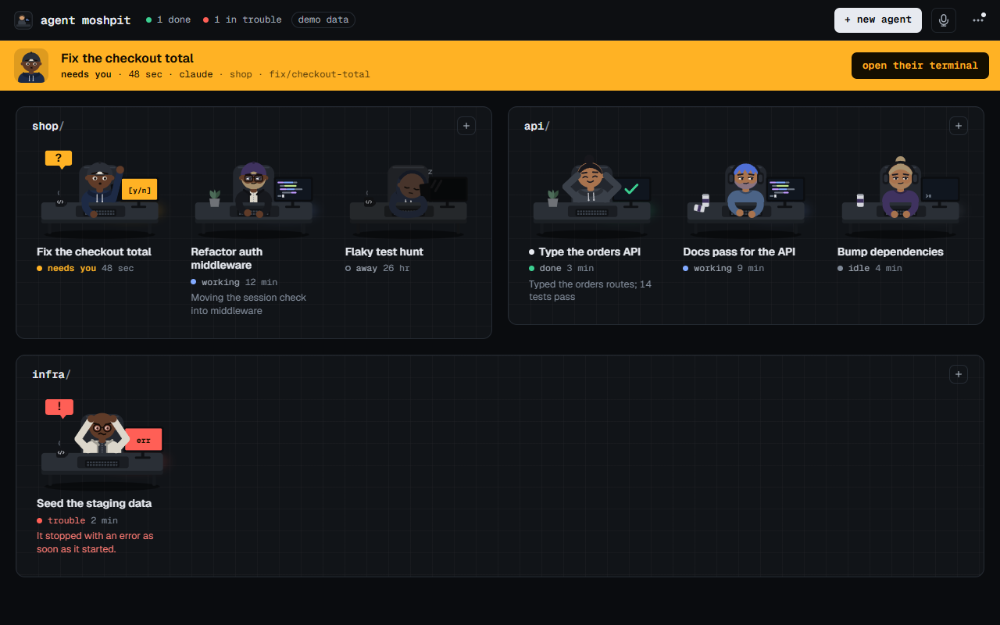
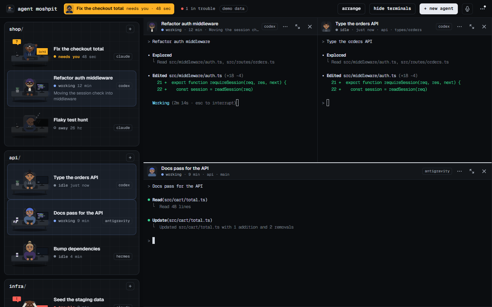
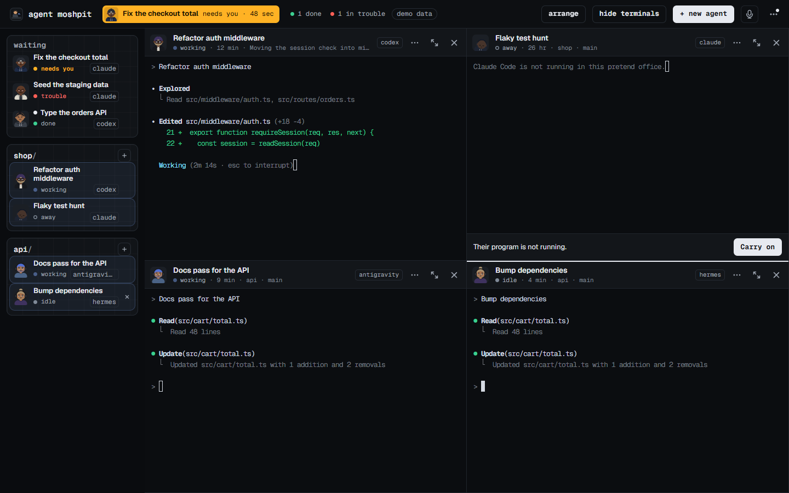
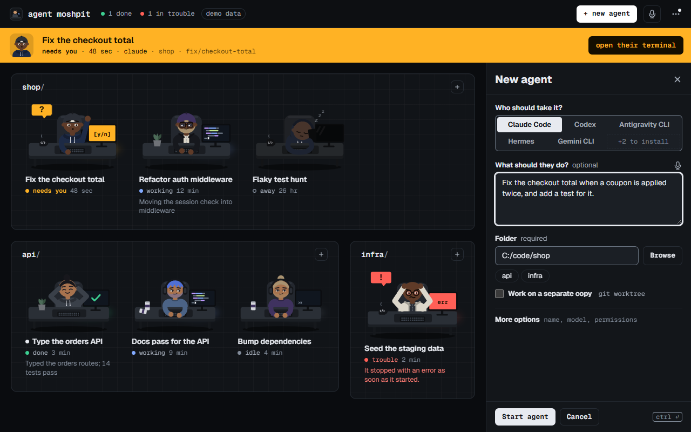

# Using Agent Moshpit

Everything the window does, in the order you meet it. For installing it, see the [README](../README.md); for the programs it can run and adding your own, [programs.md](programs.md).

| Terminals beside the floor | The floor as a strip | New agent |
| --- | --- | --- |
|  |  |  |

The pictures show the built-in demo data, not a real session. The people and their status are drawn by the app; what is in the terminals is typed by hand to stand in for a program.

## What it is, and what it is not

Agent Moshpit starts the agent programs you already have, each in a pseudo-terminal of its own, as child processes of the app. Everything under a pane's header is that program's own screen: its prompt, its slash commands, its approvals, its settings. The office draws none of it. What the office adds is the floor, where one look tells you the state of every agent and whoever needs you is brought to the top.

- **It runs your own programs with their own sign-ins.** It keeps no account, and no API key except a voice provider's, if you choose cloud voice, kept in your system's keychain. You can inherit each CLI's settings or save explicit model, effort and permission overrides with an individual desk. Optional voice runs a speech model on this computer, or a cloud provider with your own key.
- **It is not a harness.** There is no conversation view, no diff view and no Approve button of the office's own. A question is answered where the program asks it.
- **It sends nothing about you or your work.** It asks two questions about versions, when it starts and every 12 hours, unless `MOSHPIT_NO_UPDATE_CHECK` is set: npm (`npm view <package> version`), for the newest version of each installed program that is published there, and its own releases on GitHub, for a newer version of the office. There is no telemetry and no remote font or script. The programs it starts talk to their own services as they always do. An install or an update runs only when you press its button, in a terminal where you see every line.
- **Nothing is a separate window.** There is one Agent Moshpit button in the taskbar. Each program is a process of its own under the app, and is ended when the app quits.
- **It shows the agents you start from it.** A session you started in another terminal, or in a desktop app, does not appear.
- **A link in a terminal opens in your browser**, and only if it is an `https` address or an `http` one on this computer. The window itself cannot be sent anywhere. A file path is only ever handed to your editor: nothing a program prints is run.
- It is not affiliated with Anthropic, OpenAI, Google, Nous Research or the makers of any other program it can run, nor with Gather.

## Start an agent

Press **+ new agent** (`n` on the floor, `Ctrl+Shift+N` anywhere, or **New agent…** in the tray menu). The **+** on a room's sign opens the same form on that room's folder.

The form asks who, what and where, in that order. The folder is filled in with the one you most likely mean: the terminal you are in, else where you last started an agent, else the room with the most people. Everything with a good default is folded into one **More options** line that says what it is set to.

- **Who should take it?** The programs found on this computer. Ones the office can install sit behind **+N to install**. Choosing one shows the exact command, and the button becomes **Install … and start**: the install runs in a pane where you can watch it, and the agent then starts in that pane.
- **What should they do?** Optional, and offered only for programs that take a task as they start (Claude Code, Codex, Antigravity CLI, Gemini CLI). Leave it empty and say it in their terminal. Hermes, and the programs the office knows only by name, start in the folder and wait for you there.
- **Folder.** Filled in for you; type another, browse for it, or pick one used before.
- **Work on a separate copy**, where the program can (Claude Code, Codex, Hermes). The program is asked to make a git worktree of its own (`--worktree`), so several agents can change one project without colliding.
- **More options:**
  - **Name.** Optional. Left empty it is the start of the task, or the program and folder: "Claude in web", then "Claude in web 2".
  - **Model and Effort**, for Claude Code and Codex. The model picker reads your installed CLI's catalog, including each model's supported effort levels. It checks again when the form opens after the 15-minute cache expires, and every 15 minutes while the form stays visible. **Refresh** checks immediately. Newly available models and effort levels need no app update; availability follows your CLI and account. **Custom model…** accepts a model ID or alias, even when discovery fails. **Use CLI settings** passes no override.
  - **Permissions.** Claude offers Manual, Auto, Accept edits, Plan, Don't ask and Bypass permissions when the installed version supports them. Codex offers workspace and read-only sandboxes, automatic approval review, YOLO and custom sandbox/approval settings. Each choice explains its behavior; the choices are not interchangeable between programs.
  - **Advanced launch settings.** Additional folders; Codex profiles and live search; or Claude tool allow/deny rules, Chrome integration and extra instructions. Options appear when the installed CLI exposes them. **Reset to CLI settings** clears this program's overrides.

`Ctrl+Enter` starts the agent from anywhere in the form. Closing the form keeps what you typed in it. Each program keeps its own launch draft when you switch between them. Explicit launch settings are saved with the desk and reused on restart, Carry on and **Start another like this**. They describe how the desk starts; the CLI can change settings later in its terminal.

The new agent walks to a desk in the room of their project, and their terminal opens in a pane of its own.

## The floor

One room per project (the git repository's name, or the folder's), a desk per agent. A desk shows the person, a name, a status with how long it has lasted, a tag saying which program it is, and one line about what is going on.

| Status | How they look | What it means |
| --- | --- | --- |
| Starting | sitting, three dots on the screen | The program has been started and has not settled yet. |
| Working | typing, code on the screen | It is at work. |
| Quiet | sitting at a prompt | No recent output. It may still be working; completion has not been confirmed. A full minute of silence counts as finished. |
| Needs you | a hand up, an amber tag, an amber screen | It has stopped on a question only you can answer, in its terminal. |
| Done | leaning back, a green tick on the screen | It finished a stretch of work that you have not looked at yet. |
| Idle | sitting at a prompt | Running, with nothing to do. |
| Trouble | hands on their head, a red tag, a red screen | The program could not be started, or stopped with an error as soon as it started. |
| Away | asleep, the screen dark | Not running. The desk shows where they left off and offers to start them again. |

A status is always a word and a pose as well as a colour. Four colours carry meaning and are used for nothing else: amber for needs you, green for done, red for trouble, and blue for the light of a screen at work.

- Under the name, a line appears only when there is something the status does not say: what the agent reported it is doing (agents can tell the office through its MCP tools), what the program asked, or what went wrong. The program's name shows when you run more than one program.
- A small dot before a name means their terminal has printed something since you last had it in front of you. Someone at work prints all the time, so they do not get one.
- The top bar counts only what wants a look (`1 done`, `1 in trouble`); each count is a button that shows the next desk in that state. In a narrow window, one button opens the same actions in the menu.
- With more than ten agents and no terminals open, desks are drawn smaller so a crowd fits.
- The floor is one stop for `Tab`. The arrow keys walk from desk to desk and `Enter` opens one.

## Terminals

Click a desk and their terminal opens to the right of the floor, with the keyboard in it. A click on another desk shows that one in the same pane, except that a pane whose agent needs you or is in trouble is never the one put away, and on a screen wide enough for both the new one opens beside it. Hold `Ctrl` as you click, or press `Ctrl+Enter` on a desk, to open it beside the others instead: two sit side by side, more make a grid, as many as you like. Do the same on a desk that is already open and its pane is put away again, with its program still running.

- **Each pane is headed by its agent**: face, name, status, what the agent says it is doing (else project and branch), and program.
- **The grid stays as you made it.** A new pane goes beside its neighbour, and a closed one gives its room to a neighbour; nothing else moves. Drag any edge between two panes, or double-click one to make them all even. Drag a pane by its header onto another to swap the two.
- **Give one pane the room** with `Ctrl+Shift+Enter`, the button in its header, or a double-click on the header. A **+N** chip lists the ones waiting behind it and puts them back.
- **Put a pane away** with its × or `Ctrl+Shift+W`. The program keeps running at its desk.
- **Hide the terminals, and bring them back,** with `Ctrl` + `` ` `` or the button in the bar. The same panes return. Pick a desk while you are on the floor and they return with that desk among them. `Esc` is not used for this, because the programs use it themselves.
- **The floor beside the terminals** keeps the width you drag it to. Two or more panes, more than ten agents, or a laptop-sized window start with the strip, until you choose a width yourself. Below 300 pixels it becomes a strip: a list of names, each with its status and program, with whoever needs you, is in trouble or is done gathered on top under **waiting**. Double-click that edge, or choose **Compact floor** in the menu, to switch between the strip and the usual width.
- In a window narrower than 760 pixels the terminals take the whole window and the floor waits behind them.

## In a terminal

Whatever you type goes to the program, apart from the office's own keys, which are listed under [Keys](#keys).

- **Copy.** `Ctrl+C` copies when text is selected; with nothing selected it goes to the program. **⋯ → Copy on select** copies as soon as you select.
- **Paste.** `Ctrl+V`, or right-click and **Paste**.
- **A picture on the clipboard.** `Ctrl+V` saves it as a file under `pasted/` in the data folder and pastes that file's path, so the program is given the picture as a file.
- **Files dropped on a pane.** Their paths are pasted into that pane, in quotes where a path has a space. The pane lights up before you let go.
- **A file path** such as `src/app.ts:42`. `Ctrl` and a click opens it in your editor at that line. The office looks for Cursor, VS Code, Windsurf, Antigravity and Zed and uses the first it finds, until you choose one under **⋯ → Agent programs → Files open in**. With none of them here, the file is shown in its folder.
- **A web address.** A click opens it in your browser.
- **Find** in what a terminal has shown with `Ctrl+Shift+F`.
- **Text size.** `Ctrl+=`, `Ctrl+-` and `Ctrl+0`, or `Ctrl` and the mouse wheel. It is remembered.
- **Right-click** for Copy, Paste, Select all, Find and Clear the scrollback, followed by everything in the desk's own menu.

Each terminal keeps 5,000 lines of scrollback, and the core keeps the last half megabyte each program printed, so a pane that was put away, or a window that was closed, comes back showing the screen as it stands.

## Voice input

Voice starts off, and it understands English only. Press the microphone in the top bar (or **⋯ → Voice input**) and tick **Enable voice input**. Then choose where your speech becomes words.

**On this computer · English** is the default. NVIDIA's Nemotron Speech Streaming model runs on your processor, and nothing you say leaves the computer. Press **Download**: the model comes from **Hugging Face** (no account or payment), goes into the app's data folder, separate from the installer, and is checked for its exact size and SHA-256 before it is used. An interrupted download resumes where it stopped; a failed one is never used. **Remove** deletes it.

- **Nemotron Speech Streaming**, recommended: 729,650,176 bytes (730 MB), about 1.1 GB of memory while in use.
- **Nemotron Speech Streaming, smaller**: 475,436,032 bytes (475 MB), about 0.85 GB, slightly less accurate.

**Cloud · your own key** sends your audio, while you dictate and only then, to one of five providers: **Deepgram** (Nova-3), **OpenAI** (gpt-live-transcribe), **AssemblyAI** (Universal-Streaming English), **ElevenLabs** (Scribe v2 Realtime) or **OpenRouter** (ElevenLabs Scribe v2, paid from your OpenRouter credits). You pay the provider with your own account; Agent Moshpit has no account of its own there and takes no cut. The panel links each provider's key page and prices. Paste the key and press **Save**: it is checked with the provider by a call that transcribes nothing, then kept in your system's keychain (Windows Credential Manager, the macOS keychain, or the Secret Service on Linux). From then on the window sees only that a key is kept and its last four characters. Where no keychain works, the panel offers to keep the key until the app closes; it is never written to a file. **Test** checks a kept key again, and **Remove** deletes it. The audio travels over an encrypted connection whose certificate is checked against your system's own. What a provider keeps is up to its terms: Agent Moshpit asks Deepgram not to use your audio to improve its models, and ElevenLabs keeps request logs unless your plan has zero retention.

**OpenRouter works a phrase at a time.** It has no live stream to send speech down, so each phrase is uploaded whole when you pause after it and typed when the answer comes, a second or two later; nothing is shown while you are still saying it, and what you are saying when you stop goes up as the last phrase. A stretch with only the room in it is not sent, and not paid for. OpenRouter passes each phrase to ElevenLabs; what either keeps follows your OpenRouter privacy settings. It is sent the audio alone: word hints, and the desk's name, folder and branch, are not sent to it. A key that has reached its spending limit, or an account out of credit, is said in those words.

A cloud provider spells names and code words better when told to expect them. **Word hints** in the panel are your own; program names (Claude, Codex and the rest) always go with the audio, and so do the desk's name, folder, repository and branch unless you untick that.

Choose a **Microphone** in setup, or leave it on **System default**. **Refresh microphones** finds newly connected devices without recording. Close setup, select a terminal with a running program, and hold **Ctrl+Shift+Space** while you speak, or press **Voice**. A card over the terminals shows, in **blue**, the terminal's name, the microphone, the elapsed time, a live input meter and the words still being decided, and names the provider when it is one. Words are typed into the terminal as the engine settles them, usually within a second of your saying them, so by the time you finish nearly everything is there. Let go of the shortcut, press it again, or press **Stop and insert** to finish: the last few words follow in about a tenth of a second. If the meter stays empty, check mute or cancel and choose another microphone. **Cancel voice input** stops listening and drops the words not yet typed; words already typed stay in the terminal for you to keep or delete. Recording stops by itself at five minutes; silent audio is rejected. The card floats over the work, so the terminals keep their size while you talk. No microphone is opened by enabling voice, listing devices, downloading a model or adding a key. An error offers **Try again** and **Voice setup**.

The default shortcut is **Ctrl+Shift+Space**. Hold it while you speak and let go to finish, or tap it to talk hands-free and tap it again to finish. Choose **Ctrl+Alt+Shift+Space** or **No shortcut** in the panel if your program uses that key. The shortcut is reserved only while voice is enabled; plain Space and the office's existing keys retain their behavior. Holding it does not start a second recording.

**You can say an agent's first task instead of typing it.** In **New agent**, press the microphone beside **What should they do?**, or hold the shortcut anywhere in the form. The words go into the task box at the caret, spaced from what is already there, and **Undo** takes them back; a line under the box shows the words still being decided, the time, **Stop** and **Cancel**. From then on they are ordinary text: edit them, and they are kept with the rest of the form if you close it. **Start agent** while still listening finishes the recording first, so the last words are part of the task. Closing the form, or choosing a program that takes no task, stops the microphone. If voice is not set up yet, the microphone opens setup and the form keeps what you typed.

Changing keyboard focus does not change the destination. Text goes only into the pane and live terminal session selected at recording start. Closing/putting away that pane, hiding it behind a zoomed pane, stopping/restarting its program, cancelling, changing voice settings, minimising or closing the window ends the recording and drops the words not yet typed. Closing to tray never keeps a hidden microphone running. A model download is different: it carries on while the window is minimized or closed to the tray, and only quitting the office cancels it. Terminal controls and line breaks are stripped. **Voice never presses Enter or runs/submits the text.** Review it in the terminal and send it yourself.

Other languages come out as English-sounding words. On Intel and AMD computers the local engine needs a processor with AVX2 (Intel from 2013, AMD from 2015); on an older one the panel says so and points to the cloud, which works on any processor. A cloud engine needs the internet: when the provider cannot be reached, rejects the key, is out of credit or drops the connection, the card says which, and words already typed stay. On microphone failure, check OS microphone access and the default input device; the app stops capture and explains how to retry. Linux needs a working ALSA input; macOS asks for system consent.

The local model loads while the microphone opens (about a second, the first time; what you say meanwhile is kept), in a separate helper process, so a fault in the speech engine can never take your terminals down with it. If the helper stops unexpectedly the card says so, the words already typed stay, and the next recording starts a new one. The model stays loaded for five minutes after your last recording, so the next one starts at once, and is then let go. Audio and transcripts are kept only in memory and discarded when the recording ends. Voice leaves the clipboard alone. To avoid retaining dictated text through terminal echo, a desk that receives voice text skips the app's saved-screen file for that app run; its conversation is still owned and potentially saved by its CLI. Other desks retain their usual screen snapshots. [Why this engine, with the numbers measured](research/voice-engines-2026-10.md).

## When someone needs you

Amber means one thing here: someone needs you.

- Their hand goes up at their desk, with a line saying what for when the office knows.
- On the floor, a band across the top names whoever has waited longest, what they asked when the program said, and has one button, **Open their terminal**, which opens it beside whatever is already open. Anyone else waiting is listed on the band; a click on a name opens theirs.
- While terminals are open the band is an amber chip in the top bar instead, so your terminals never move when a hand goes up. Click it, or press `Ctrl+Shift+A` from anywhere, even inside a terminal, to go to whoever has waited longest; press it again for the next.
- The window's title becomes `Agent Moshpit (2 need you)`, the taskbar button flashes if the window is behind, and the tray icon changes.
- You get a notification, unless you are looking at that terminal.

The hand stays up until the question is answered in their terminal. Going back to the floor, or opening another pane, does not lower it.

How the office knows, without ever reading the words on a program's screen:

- **Claude Code says so itself.** It keeps a small file about each running session (`~/.claude/sessions/<pid>.json`), and the office reads from it whether Claude is busy, idle or waiting.
- **Every other program is read from how its terminal behaves.** One that keeps printing is working. After it has worked, silence shows **Quiet**, because it may still be working. A completion notice confirms **Done**, or **Idle** if you are looking at that terminal. Most programs never send one, so a full minute of silence counts as finished too: Claude Code and Codex keep a spinner or status going while they work, and a minute without output is the end of the stretch. One that rings the terminal's bell or sends a terminal notice wants you, or has finished if the notice says so. Codex is started with its terminal notices turned on for this.
- **A folder nobody has trusted yet.** Claude Code and Codex first ask whether to trust a folder they have not been told about. The office reads their own settings before starting one, and shows **needs you**, "Asks whether to trust this folder", until you press a key in that terminal.
- **A task that stops at once.** A program handed a task that goes quiet almost immediately, before anyone has typed, shows **needs you**, "Asked something before starting".

A green tick means they finished something you have not seen. Bring their terminal in front of you and it comes down.

## Notifications

The office tells you when an agent needs you, is done, or hit a problem, unless you are looking at that agent's selected terminal. Panes behind a form, a menu or another zoomed pane are not treated as read. On Windows a click on the notification opens the office with that desk's terminal beside the others, and starts the office first if it had quit; a newer notification about a desk takes the place of the older one.

## A desk's menu: rename, restart, stop, remove

Right-click a desk on the floor, in the strip or on a pane's header, press `Shift+F10` on it, or use the ⋯ on its pane.

- **Open their terminal**, or **Open beside the others**.
- **Start another like this.** The New agent form, on the same program and folder.
- **Rename** (`F2`). An emptied name goes back to the one the desk was given. Claude Code's own name for a session is used until you name the desk yourself.
- **Restart their program** and **Stop their program.** Stop ends the program and keeps the desk, away. Both ask first if the agent is working, quiet, starting or waiting for you, and the menu says which conversation it can resume or whether it starts afresh.
- **Carry on**, **Continue in folder**, **Continue latest** or **Start again**, for a desk whose program is not running. The hint explains what it resumes.
- **Open the folder in** your editor, **Show their folder**, **Copy the folder path**.
- **Remove this desk.** Also a middle-click, `Delete`, or the × on a row of the strip beside the terminals. The desk leaves the floor at once and can be brought back with **Undo** for eight seconds; after that its program is ended and the desk is gone. Consecutive removals share **Undo all**, and the timer pauses while the pointer or keyboard focus is on the notice. Closing the notice finishes the removals. If the agent is busy you are asked first. The program keeps the conversation in its own history, and nothing of yours is deleted: the folder, and a worktree a program made for a separate copy, are left as they are.

## Closing the window, and quitting

Closing the window does not quit. The window goes and the office stays in the tray: agents keep working, the tray icon shows when someone needs you, and notifications still arrive. The first time, a notification says so. Click the tray icon, or start the app again, and the window comes back with the panes it had.

- **To quit**, use **Quit Agent Moshpit** in the tray menu or the ⋯ menu, or press `Ctrl+Shift+Q` (`Ctrl+Q` works too when the keyboard is not in a terminal). Quitting ends every agent's program. If anyone is busy you are asked first, and told who will carry on later and who will start afresh.
- **⋯ → Closing the window quits** makes the window's × quit instead, asking first if anyone is busy. It is off by default.
- On a desktop with no tray, closing the window quits.

## What comes back after a restart

- Every desk is back, away. Nothing is started until you ask.
- Opening a desk shows its last screen as it was drawn when the office quit, with up to 500 lines above it, and a resume or **Start again** button.
- **Carry on** resumes this desk's saved session for Claude Code or Codex once its session is known. **Continue in folder** asks Antigravity for the folder's latest conversation. **Continue latest** asks Hermes, or a program without a saved-session argument, for its latest conversation; that may belong to another desk. Unsupported programs start afresh in the same folder.
- The window has the size and place it had, the same floor width and text size, and `Ctrl` + `` ` `` brings back the panes that were open.

What does not come back is a terminal's scrollback beyond that last screen.

## The ⋯ menu

- **Agent programs.** Every program the office knows, with its version, whether a newer one is out, and a button to install or update it. The command that will run is written beside the button, and it runs in a pane. A program you install while the office is open, yourself or with a button here, is found without restarting it: the office looks again when you open this panel or **New agent**, and when you come back to its window. That includes Node.js. Most of these programs are installed with npm, which comes with Node.js; on a computer without it, the panel and **New agent** say so before you press anything, with a **get Node.js** button, and install as usual once it is there. This panel also chooses the editor that file paths open in.
- **Voice input.** Enable voice, choose where speech becomes words (this computer, or a cloud provider with your own key), download or remove the model, add, test or remove keys, word hints, the microphone and the shortcut.
- **Configuration warning**, while a startup warning is unresolved. Opens the warning again after it has been dismissed, with its file action. Moving between desks never clears it.
- **Compact floor**, while terminals are open.
- **Make the terminals even**, when more than one is open.
- **Copy on select**, off by default.
- **Closing the window quits**, off by default.
- **Keys.** Every shortcut in one list.
- **Quit Agent Moshpit.**
- **Update to …**, at the top, when a newer version of the office is out (a dot on ⋯ says so). Choosing it fetches the update, checks it against the app's own key, puts it in place and starts the office again. If anyone is busy you are asked first, and told who will carry on. Nothing is fetched before you choose it. If it cannot be had, the office says why and offers the download page instead.

## Keys

| | |
| --- | --- |
| **Anywhere** | |
| `Ctrl+Shift+A` | To whoever needs you, in their terminal; again for the next |
| `Ctrl` + `` ` `` | Hide the terminals, and bring them back |
| `Ctrl+Shift+N` | New agent (`n` on the floor) |
| `Ctrl+Shift+Q` | Quit, asking first if anyone is busy |
| `Ctrl+Q` | The same, when the keyboard is not in a terminal (there it is the program's) |
| `Ctrl+Shift+/` | The list of keys (`?` on the floor) |
| `Esc` | Close a side panel or a menu, when the keyboard is not in a terminal |
| **Terminals** | |
| `Ctrl+Shift+Space` | Voice, when enabled: hold to talk, or tap to start and tap to finish (configurable in Voice input). Into the terminal in front, or the task in New agent |
| `Alt+1` … `Alt+9` | The keyboard to pane 1 to 9 |
| `Ctrl+Shift+]` / `Ctrl+Shift+[` | The keyboard to the next pane, or the one before |
| `Ctrl+Shift+Enter` | Give this pane the room, and put the others back |
| `Ctrl+Shift+W` | Put this pane away; its program keeps running |
| `Ctrl+Shift+F` | Find in what this terminal has shown |
| `Ctrl+=` / `Ctrl+-` / `Ctrl+0` | Bigger text, smaller, the usual size |
| `Ctrl+C` | Copy, when text is selected; otherwise the program's |
| `Ctrl+V` | Paste. A picture is pasted as the path of a file holding it |
| `Shift+Enter` | A new line in the program's prompt |
| `Shift+Tab` | The program's (Claude Code's mode switch); the keyboard stays in the terminal |
| **On the floor** | |
| Arrow keys | From desk to desk |
| `Enter` | Open their terminal |
| `Ctrl+Enter` | Open it beside the others, or put it away again |
| `F2` | Rename |
| `Delete` | Take the desk away (it can be brought back for a moment) |
| `Shift+F10` | The desk's menu |
| **With the mouse** | |
| `Ctrl` and a click | Open a desk beside the others, or put it away again |
| `Ctrl` and a click on a file path | Open it in your editor, at its line |
| `Ctrl` and the wheel | Bigger or smaller text, over a terminal |
| Right-click | A desk's menu, or a terminal's |
| Middle-click | Take a desk away |
| Drag a pane's header | Onto another pane, to change places |
| Double-click a pane's header | Give it the room |
| Drop files on a pane | Their paths are pasted into it |

## Settings from outside

| Variable | What it does |
| --- | --- |
| `MOSHPIT_NO_UPDATE_CHECK` | Set to anything, the office never asks for newer versions: not npm about the agent programs, and not GitHub about itself. |
| `MOSHPIT_UPDATE_URL` | Ask this address about newer versions of the office instead of its releases on GitHub. Used by the tests. |
| `MOSHPIT_UPDATE_ONLY_FETCH` | Set to anything, an update is fetched and checked and then left alone. Used by the tests. |
| `MOSHPIT_DATA_DIR` | Keep the office's files in this folder instead of the app's data folder. |
| `MOSHPIT_INSTANCE` | A name (letters and digits) that makes this a separate office next to the one already open: its own window, data folder, window title ("Agent Moshpit (name)") and notification address. `--instance name` on the command line does the same. Used by the tests. |
| `MOSHPIT_DEVTOOLS` | Set to anything, the webview's browser keys are left on (F5 reloads the window; in a debug build F12 opens the developer tools), for working on the window itself. Windows. |
| `MOSHPIT_APP` | Read by the app tests only: the path of the program to test. |

The office also reads `CLAUDE_CONFIG_DIR` and `CODEX_HOME`, the programs' own variables, to find where each keeps the folders it trusts.

On the command line: `--hidden` starts in the tray with no window, and `--instance name` is described above.

## Where things are kept

The data folder is `%APPDATA%\io.github.yashingole.agentmoshpit` on Windows, `~/Library/Application Support/io.github.yashingole.agentmoshpit` on macOS and `~/.local/share/io.github.yashingole.agentmoshpit` on Linux, unless `MOSHPIT_DATA_DIR` says otherwise.

| File | What is in it |
| --- | --- |
| `desks.json` | The desks: which program, the name, the folder, and the id of the conversation when it is known. |
| `window.json` | The window's size and place. |
| `settings.json` | Whether closing the window quits; voice preferences: on or off, engine, model, shortcut, microphone, word hints, whether desk names go as hints. Written when changed. |
| `voice-models/` | The verified optional speech model, with a small stamp beside it so it is not read in full at every start. No recordings or transcript files. An interrupted download is kept as `.part` to resume, never used. |
| `voice-keys.json` | Which cloud providers have a key, its last four characters and when it was added. Never a key: those are in the system keychain. |
| `screens/` | Each desk's last screen, written when the office quits. |
| `pasted/` | Pictures pasted into terminals. Cleared after a week. |
| `harnesses.json` | Your own programs, if you wrote any. |
| `told-about-tray` | An empty marker, so the notice about the tray is given only once. |

The layout of the panes, the floor's width, the text size, the editor you chose, copy on select and the folders used before are kept by the window itself, in the webview's storage (on Windows under `%LOCALAPPDATA%\io.github.yashingole.agentmoshpit`).

Conversations are not kept by the office. Each program keeps its own history where it always does.

On Windows the office also writes one entry under `HKEY_CURRENT_USER\Software\Classes\agent-moshpit` each time it starts. That is what lets a clicked notification open a desk: the notification opens an `agent-moshpit://desk/…` address, and Windows hands it to the app.
